This is an example ZMK configuration for HSHS52 and HSHS46. This configuration is based on the [Hillside ZMK config by mmccoyd](https://github.com/mmccoyd/zmk-config).

## Keymap

Redrawn automatically by [keymap-drawer](https://github.com/caksoylar/keymap-drawer) (`.github/workflows/draw.yml`) whenever the keymap changes. Small labels under a key are what it does when held.
